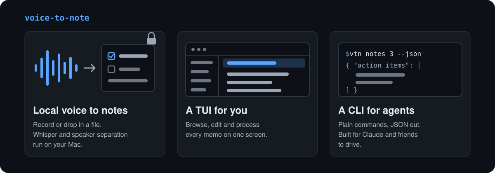

# voice-to-note

Record a meeting on your Mac and get a transcript, notes and to-dos back,
with the audio never leaving the machine. macOS only.



**Voice to notes with local models.** Record a meeting or drop in a file.
whisper.cpp transcribes and sherpa-onnx separates the speakers on your Mac.
You get named speakers, structured notes and to-dos. Only the note-writing
step uses an LLM, and with Ollama even that stays local.

**A TUI for people.** One screen to browse, edit and process memos, projects
and the to-do board: `vtn tui`.

**A CLI for agents.** The same use cases as plain commands: results on stdout,
progress on stderr, `--json` on the reading commands. Extraction runs through
the `claude`, `codex` or `gemini` CLI you are already signed in to, or a local
Ollama model. No API keys.

```sh
vtn notes 3 --json | jq .action_items
```

## Install

```sh
curl -fsSL https://raw.githubusercontent.com/drobiAlex/voice-to-note/main/install.sh | bash
```

Needs macOS, the Xcode Command Line Tools, `cmake` and `ffmpeg`; the installer
names whatever is missing. It sets up `uv`, `vtn`, whisper.cpp and the models.
Re-run it to upgrade.

## Quick start

```sh
vtn record --project work         # tape this Mac's meeting, then process it
vtn process ~/memos/standup.m4a   # transcribe, diarize, extract notes
vtn youtube <url>                 # import a video's captions as a memo
vtn tui                           # browse and edit everything
vtn notes 3                       # print the notes for memo 3
vtn todos                         # open to-dos across all memos
vtn ask 3 "who owns the launch?"  # ask a question about a memo
```

`vtn --help` lists the rest.

## What else it does

- Name a voice once and later recordings recognise it.
- To-dos survive re-extraction: checked-off items stay checked.
- Projects, tags, an archive drawer and a bin that deleted memos wait in until you empty it, from the TUI or the CLI.
- Live transcription while a meeting records.
- Custom note templates beside the built-in ones. A template can add sections of its own with a few lines of TOML front matter (the shipped `video` template asks "Worth watching?", "Questions answered" and "Hidden insights"), and can ask the person questions first, answered in the TUI or with `--var key=value` (see below), each kind of source has its own default (`vtn config` → `youtube_template`, `record_template`, `file_template`), and a memo remembers its template for the next re-extraction.
- A menu bar recorder: [`docs/menubar.md`](docs/menubar.md).

### A template that asks

A note template is a markdown file in `$VTN_HOME/templates/`, optionally opening with TOML front matter between two `+++` lines. `[sections]` adds headings to the notes; `[ask]` names questions put to you before the work starts. Every answer is optional.

```
+++
[ask]
goal = "What do you want out of this video?"
audience = "Who are these notes for?"

[sections]
"Worth watching?" = "Yes or no, and why, judged against the goal when one is given."
+++
Extract structured notes from this transcript.
The person wants this out of it: {goal}
...
Transcript:
```

`{goal}` in the text is replaced by the answer (`(not given)` when there is none); the answers are also listed before the transcript, so a template need not use the placeholder at all. `{title}`, `{channel}`, `{url}`, `{recorded}` and `{project}` are available in every note template, and the model is always told what is known about the recording (a video's title, channel, link and upload date). In the TUI the questions appear after you submit an import form or pick a template to re-extract with, prefilled with the last answers. On the command line, answer with `--var goal="learn the basics"` on `process`, `record`, `youtube` and `extract`; `vtn template` lists each template's question keys, `vtn info` shows what a memo's notes were answered with, and re-extracting reuses the stored answers unless you override a key.

## Roadmap

What is shipped and what is next: [docs/roadmap.md](docs/roadmap.md).

## Development

`./run.sh` is the development entry point — it keeps the database, models
and whisper.cpp build inside the checkout via `VTN_HOME`.

```sh
uv run pytest -q
uv run mypy src
uv run ruff check src tests
```

CI runs all three on every push, with a coverage floor of 84%.

## Third-party notices

The spring physics in `src/voice_to_note/native/springs.swift` comes from
[MacPaw/CocoaSprings](https://github.com/MacPaw/CocoaSprings), copyright © 2023
MacPaw Inc., under the MIT License. The vendored file includes the full license,
upstream headers, and the source commit; platform animation wrappers are not included.

## License

MIT — see [LICENSE](LICENSE).
