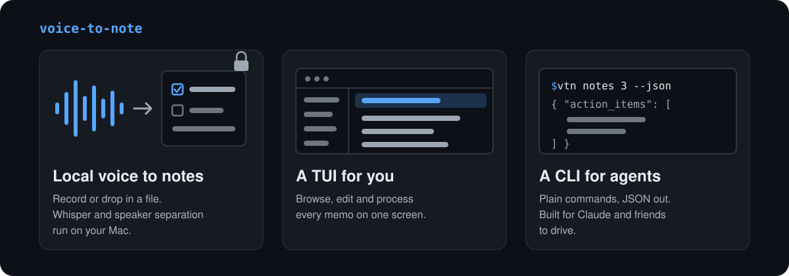

# voice-to-note

Record a meeting on your Mac and get a transcript, notes and to-dos back,
with the audio never leaving the machine. macOS only.



**Voice to notes with local models.** Record a meeting or drop in a file.
whisper.cpp transcribes and sherpa-onnx separates the speakers on your Mac.
You get named speakers, structured notes and to-dos. Only the note-writing
step uses an LLM, and with Ollama even that stays local.

**A TUI for people.** One screen to browse, edit and process memos, projects
and the to-do board: `vtn tui`.

**A CLI for agents.** The same use cases as plain commands: results on stdout,
progress on stderr, `--json` on the reading commands. Extraction runs through
the `claude`, `codex` or `gemini` CLI you are already signed in to, or a local
Ollama model. No API keys.

```sh
vtn notes 3 --json | jq .action_items
```

## Install

```sh
curl -fsSL https://raw.githubusercontent.com/drobiAlex/voice-to-note/main/install.sh | bash
```

Needs macOS, the Xcode Command Line Tools, `cmake` and `ffmpeg`; the installer
names whatever is missing. It sets up `uv`, `vtn`, whisper.cpp and the models.
Re-run it to upgrade.

## Quick start

```sh
vtn record --project work         # tape this Mac's meeting, then process it
vtn process ~/memos/standup.m4a   # transcribe, diarize, extract notes
vtn youtube <url>                 # import a video's captions as a memo
vtn tui                           # browse and edit everything
vtn notes 3                       # print the notes for memo 3
vtn todos                         # open to-dos across all memos
vtn ask 3 "who owns the launch?"  # ask a question about a memo
```

`vtn --help` lists the rest.

## What else it does

- Name a voice once and later recordings recognise it.
- To-dos survive re-extraction: checked-off items stay checked.
- Projects, tags and an archive drawer, from the TUI or the CLI.
- Live transcription while a meeting records.
- Custom note templates beside the built-in ones.
- A menu bar recorder: [`docs/menubar.md`](docs/menubar.md).

## Roadmap

Next:

- A Voice Memos watcher that processes phone recordings on its own.
- To-dos and notes on your phone through Apple Reminders and Notes.
- Switching microphone mid-meeting without stopping the recording.
- Full-text search across transcripts and notes.

The shipped list and the rest are in [`docs/roadmap.md`](docs/roadmap.md).

## Development

`./run.sh` is the development entry point — it keeps the database, models
and whisper.cpp build inside the checkout via `VTN_HOME`.

```sh
uv run pytest -q
uv run mypy src
uv run ruff check src tests
```

CI runs all three on every push, with a coverage floor of 84%.

## Third-party notices

The spring physics in `src/voice_to_note/native/springs.swift` comes from
[MacPaw/CocoaSprings](https://github.com/MacPaw/CocoaSprings), copyright © 2023
MacPaw Inc., under the MIT License. The vendored file includes the full license,
upstream headers, and the source commit; platform animation wrappers are not included.
